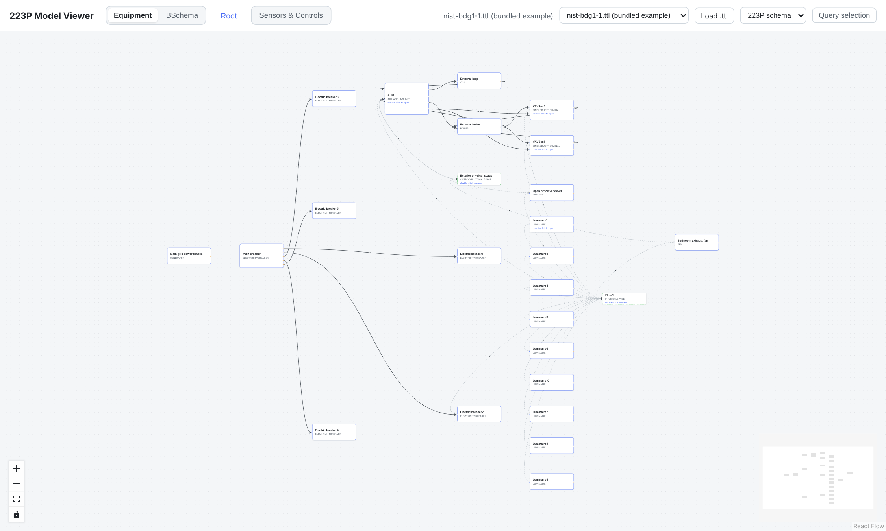
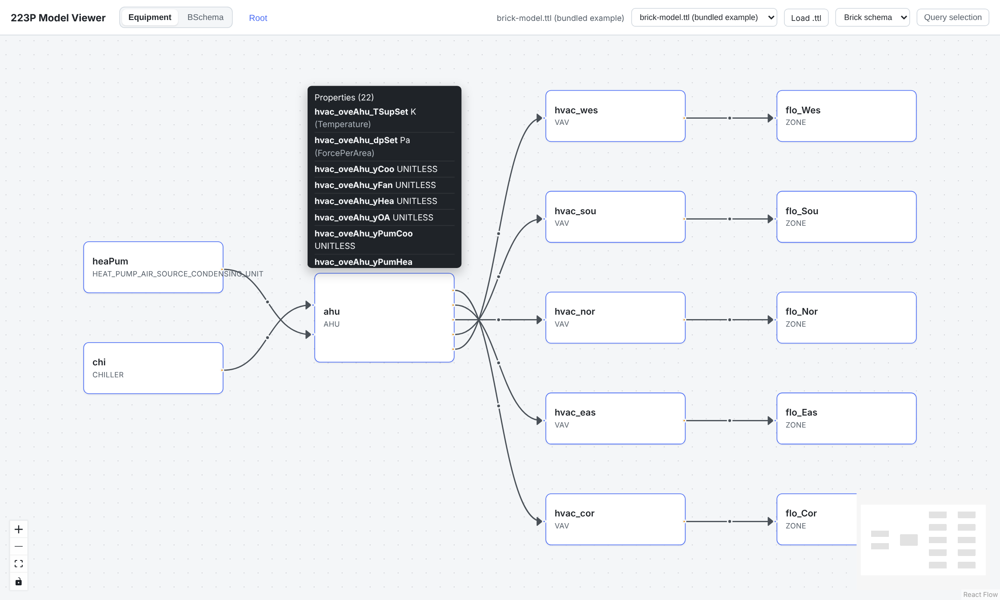
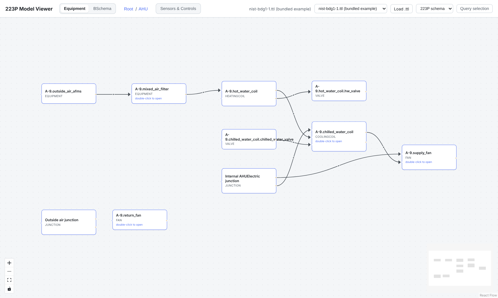
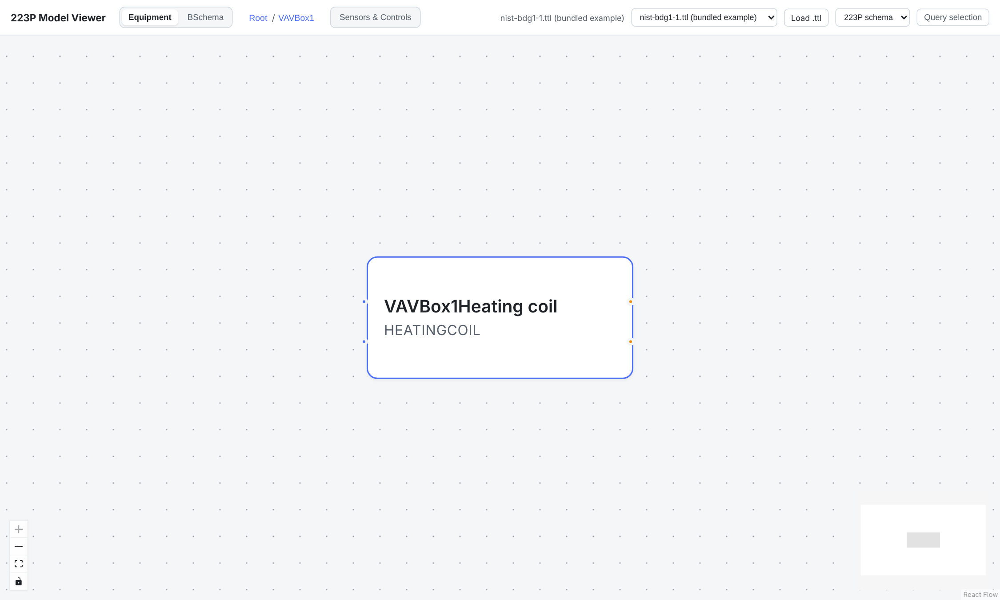
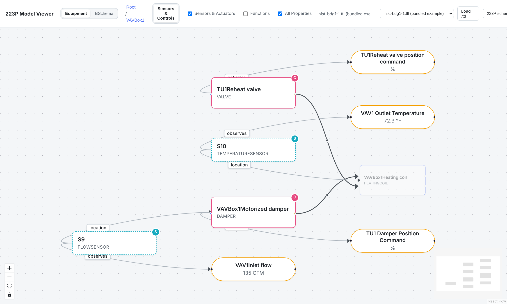
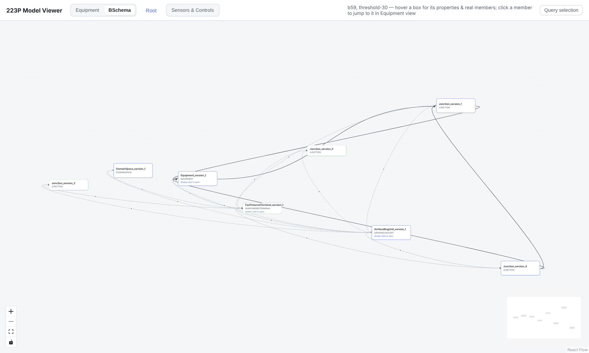
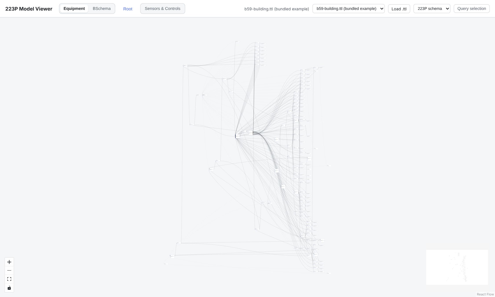

# Show the building, not the graph

*How we use the ontology itself to make ASHRAE 223P and Brick models readable, and what we got wrong along the way.*

Semantic building models are good at their job. ASHRAE 223P can tell you that the
supply fan inside AHU-1 pushes air through a specific duct into the inlet of VAV box 3,
that a temperature sensor observes the air in that duct, and that a controller uses
the sensor's reading to drive a reheat valve. Brick can tell you which points belong to
which equipment, and which equipment feeds which zone. Analytics and control software
can be written once against that structure and reused across buildings.

The trouble starts when a person wants to look at one.

*The NIST reference office building: 1,707 triples, shown as 25 boxes and 45 arrows.*

## Why the literal graph is the wrong picture

In 223P, "the AHU is ducted to the VAV box" is not one edge. It is at least five nodes:
the AHU, its outlet *connection point*, a `Duct` (a kind of `Connection`), the VAV's inlet
connection point, and the VAV. Each property hangs further nodes for its quantity kind
and unit. Our small reference model has 1,707 triples over 432 distinct nodes. A real
building we work with has **38,982 triples**.

A generic RDF browser draws all of it, faithfully, as a hairball. That faithfulness is
the problem: most of those nodes are *scaffolding*, not things an engineer would put on a
drawing.

We built [223p-viewer](https://github.com/lazlop/223p-viewer), a browser app (no
backend) that also runs as a notebook widget. It started from one idea:

> **The ontology already tells you which nodes are "things", how they nest, and which
> relations are plumbing. Use that before you lay anything out.**

The rest of this post covers the techniques that came out of that idea, the ones we
tried and dropped, and where the approach still falls short.

---

## Part 1: Shrink the graph using what the standard means

### Connections become arrows

We take every connection point and hub (`Connection`, `Duct`, `Pipe`, `Conductor`) linked
by `cnx` or `connectsThrough` and union-find them into connected components. Inside
each component, every outlet is paired with every inlet, and each pair becomes **one
arrow between the two pieces of equipment**. The duct is no longer a node. It survives
as the arrow's label, its medium, and any properties it carries. In the reference model,
214 topology triples and 50 hub nodes become 88 arrows.

Using union-find instead of assuming exactly one hub between two ports means long hub
chains collapse the same way, and a direct port-to-port link still works.

### Connection points become ports

A connection point is not a box. It's a dot on the edge of its owner: inlets on the left,
outlets on the right, colored by medium. Arrows attach to the exact dot they use, so each
box reads like a schematic symbol.

### Properties and points go in the tooltip

Properties (value, unit, quantity kind) are listed when you hover a box. The same trick
lets us support **Brick through the same pipeline**: a Brick Point reached via
`hasPoint` is, in effect, a 223P Property. We fold it into its equipment's list, and
`feeds` becomes an arrow between ports we create for it.

*A Brick model: 72 points, zero extra boxes. Hover the AHU to see its 22.*

### Containment is the zoom level

`contains` and `encloses` form a tree. The canvas shows one level at a time; you
double-click to go inside, and a breadcrumb takes you back out. What's on screen depends
on how many things sit at one level, not on the size of the building.

*Inside the AHU: filter, coils, valves, fans, and the ducts and pipes between them.*

Real data under-declares containment, especially for sensors. A sensor that observes a
property of a VAV box but is never `contains`'d anywhere would otherwise float at the top
level. For nodes with no structural parent, we fall back to a *functional* parent: the
owner of what it observes or actuates, then its location, then whatever executes it. Only
one parent is chosen, so it stays a tree. That fallback supplies 20 of the 70 parent
links in the reference model.

### Don't drop edges, roll them up

This one mattered most. Most real 223P connections cross container boundaries. A
luminaire's circuit runs to a breaker in a panel somewhere else, and a VAV's hot-water
inlet runs to a boiler outside every room. If you only draw edges whose two ends are both
on screen, most of the building looks disconnected.

So we walk each endpoint up the tree to the nearest box that *is* visible at this level.
An edge that lands on its real ports is drawn solid and port-to-port. One that had to be
projected upward is drawn **dashed**, and parallel ones merge into a single
"*n* connections" arrow. At the reference model's root, 19 of 45 arrows are rolled up.
**Nothing vanishes silently**, which became a design rule for the whole project.

### Hide the instrumentation layer until asked

By default, sensors, actuators and functions aren't drawn in the equipment view, and
uncontained ones never appear at the top level. The next section covers how they come
back.

---

## Part 2: Reveal the rest on demand

### Sensors & Controls is an overlay, not a separate page

Our first version had a separate "points" canvas. It answered *what sensors exist* but
not *where they are*. So we merged it into the equipment view as a toggle that **overlays
the same hierarchy**:

*Inside VAV box 1, before and after the overlay. Sensors and actuated equipment get
colored borders, properties become pills showing their values, and the heating coil,
which has no data of its own, is greyed out.*

With the overlay on:

- **Property pills.** Each observed or actuated property is a pill, shared between the
  points that use it and wired to the box that owns it.
- **Muting.** Boxes with no properties and no instrumentation shrink and grey out, so
  you look at the boxes that carry data while still seeing the structure around them.
- **Pull-in by attachment.** A sensor is shown if it is *attached* to something here,
  even when it's filed elsewhere in the tree or nowhere at all. Real models do this a lot.
- **Three sub-toggles.** *Sensors & Actuators* is on by default. *Functions* and *All
  Properties* are off, because real models can declare a lot of them.
- **Junctions for duct properties.** A property owned by a duct (say, a mixed-air
  temperature) splits its arrow with a small junction dot, and the pill wires to that dot.

### Start from a summary when the building is big

For large buildings, even the top level is crowded. A separate summarization tool groups
structurally similar instances into classes such as `AirHandlingUnit_version_1`. Because
the summary is itself written in 223P, **it renders through the same viewer unchanged**.
In our real building, 8 top-level classes stand in for 143 top-level instances. Hover a
class to list its real members, and click one to jump to it in the instance view, already
drilled in and highlighted.

*The summary view: eight boxes to start from instead of 143.*

### Looking turns into querying

The *Query selection* sidebar lists the instances, classes, predicates and literals
behind what's on screen. That includes everything folded into a dashed rolled-up arrow,
not only its two endpoints. Click boxes to narrow it down. In the notebook widget you
pick which predicates to follow, then pick an instance, and its one-hop triples land in a
clipboard that syncs back to Python. From there they can seed a SPARQL query. The
simplified picture works as an index into the full graph.

---

## Part 3: Things we tried and dropped

### Where do Systems go? (four attempts)

`System` sounds like it should be a box with its members inside. But `hasMember` and
`contains` can each claim the same equipment, and a drill-down tree can only give each
node one parent.

1. **Every System is a box.** The "Return System", a return fan and an exhaust damper that
   are both physically inside the AHU, showed up as a separate box next to the AHU, with
   their wiring hidden inside it. Wrong.
2. **Heuristics.** Nest a System inside whichever container holds most of its members, and
   treat wiring that leaves the System as a boundary. A toggle switched between inferred
   and literal behavior. It worked, but it meant a threshold to tune and a mode to explain.
3. **A Flat/Abstracted toggle** that turned such Systems into real boxes you could open.
   On the way we tried dashed "cluster frames" drawn around a System's members. We dropped
   them: the layout knows nothing about membership, so frames overlapped each other and
   sometimes enclosed equipment that wasn't a member.
4. **Always logical (what ships).** Systems and Zones are never boxes. Each member's
   tooltip says "member of Supply System". The breaker panel with six real boundary ports
   is no exception.

The last step wasn't a bug fix; it removed a choice from the user and a code path from the
codebase. The lesson: **when two relations both claim to be the hierarchy, pick one and
show the other as annotation.** (The earlier versions are kept under a git tag, not behind
a toggle.)

### Guessing is not modeling

Twice we added a heuristic that guessed structure from names, such as "anything called
`*Sensor`, or anything with a unit, is a Brick Point". Both times we took it out. If the
model doesn't say it, the viewer doesn't draw it.

That paid off, because the viewer started catching modeling mistakes:

- A flow sensor in VAV box 1 had its observation location pointed at VAV box 2's damper,
  a copy-paste error. It showed up as a property pill floating loose inside VAV box 1.
- A Brick model's heat pump, chiller and five CO₂ sensors were missing `feeds`/`hasPoint`
  links, so they showed up as disconnected boxes.
- Summary-graph ports with many owners exposed a viewer bug: only the first owner was
  kept. The same bug had been silently dropping two breaker-to-light circuits in the
  reference model.

We fixed the data where the data was wrong, instead of teaching the viewer to guess around
it.

### Slow views are cluttered views

Clicking a box once re-ran the whole layout. On the big building with the overlay on,
each shift-click froze the page for about 13 seconds. We split layout (which depends only
on the shape of the graph) from selection highlighting (which is cheap), and clicks now
take about 150–200 ms. Separately, our crossing-reduction loop could spend 6 seconds on
one big cluster, so it now has a 400 ms budget and keeps the best layout found in that
time.

---

## Where it still falls short

*The real building's top level: 143 boxes and 320 arrows. Too dense to read.*

- **Flat exports stay dense.** The real building's export declares little containment, so
  the drill-down has little to work with. Today the answer is "start from the summary
  view". Automatic entry points or interest-based filtering are on the list.
- **Turning everything on is a lot.** At that same top level, switching on every overlay
  adds 754 pills. The defaults are conservative for a reason.
- **Valves and dampers.** They declare `actuatedByProperty`, so the plain equipment view
  counts them as instrumentation and hides them, even though they are real equipment with
  ports (see the VAV screenshot above). The fix is small; the screenshot shows the
  current behavior.
- **No user study yet.** Everything above is design rationale and hands-on experience, not
  measured comprehension. A task-based comparison against a generic RDF browser is next.

## The principles, in one place

1. **Draw the domain's things, not the triples.**
2. **One tree, one relation.** Containment decides where things sit. Everything else is
   annotation.
3. **Nothing vanishes silently.** Roll up, merge, or list it in a tooltip, but never just
   drop it.
4. **Be faithful, not clever.** Data gaps should be visible, not papered over.
5. **Conservative defaults, opt-in detail.**
6. **Removing options is a feature.**
7. **One pipeline for every input and host.** 223P, Brick, summaries and notebooks all
   share it.
8. **Latency is part of clutter.**

The code, the bundled example models and the notebook widget are at
[github.com/lazlop/223p-viewer](https://github.com/lazlop/223p-viewer). If you have a 223P
or Brick model that breaks these ideas, we'd like to see it.
